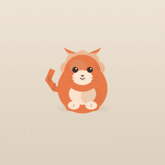
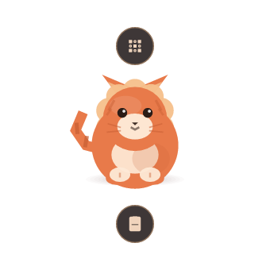
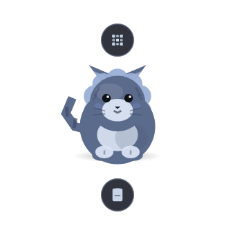

# Zouwu 驺吾

> **English** | [简体中文](README.zh-CN.md)

A tiny mythical beast that lives in the corner of your desktop. Hover it and it unfolds a
ring of bubbles — QR scanner, clipboard history, whatever commands you wire onto it.
Idle cost is **0.3% of one core and ~17 MB RSS**, because there is no webview and no
GPU: just a layered Win32 window painted with a CPU rasterizer.

<p align="center">
  
</p>

<p align="center">
  
  
</p>

<p align="center">
  <a href="https://github.com/yourname/zouwu/releases"></a>
  
  
  
</p>

Zouwu (驺吾) is a beast from the *Classic of Mountains and Seas* (《山海经》): "a rare
creature, big as a tiger, five-colored, its tail longer than its body; ride it and you
travel a thousand li a day." This app borrows the shape, not the theology: a small
five-colored creature sitting on your desktop, one hover away from the things you do
a hundred times a day.

---

## Features

Everything below is implemented and wired in the current build — no placeholder bubbles
that only write a log line (that was a deliberate cull, see [ADR-042](docs/decisions.md)).

**The widget**

| | |
|---|---|
| Always-on-top layered window | Borderless, transparent, per-pixel alpha, not in the taskbar, click-through outside the beast |
| Blink & breathe | Idle animation on a deadline scheduler; **no frame is drawn when nothing moves** |
| Bubble ring | 150 ms hover (or a click) unfolds N bubbles with a spring curve, 24 ms stagger, slow orbital float |
| Drag & remember | Drag anywhere; position survives restarts; if the screen layout changes and the beast ends up off-screen, it walks back by itself (ADR-026) |
| Tray + hotkey + single instance | `Alt+Space` summons it; closing the window only hides it; a second launch wakes the first one |

**Built-in actions**

- **QR scan** (`Ctrl+Alt+Q`) — grabs the whole virtual desktop (multi-monitor), scans it,
  shows every code found in its own window; click a row to copy.
- **Clipboard history** (`Ctrl+Alt+V`) — text only, persisted to disk, deduplicated,
  capped at 100 entries. Type to search (space = AND, IME-friendly), `↑`/`↓`/`PgUp`/`PgDn`/wheel
  to navigate, `Enter` to paste, `Delete` to remove.
- **Custom command bubbles** — add a bubble that runs any program/command; per-bubble global
  hotkeys; reorder and disable items independently.

**Desktop quality of life**

- **Eye care** — an amber overlay across the whole virtual desktop; click-through, never
  steals focus, re-raised whenever a new top-most window appears.
- **Alt-drag windows** — hold `Alt` and drag any window; `Alt`+double-click toggles maximize;
  `Alt`+wheel up/down maximizes/minimizes. Can be switched off.

**Looks and language**

- Themes as TOML overlays (built-in warm and night), skins as directories of PNG layers,
  `.zwskin` single-file skin packages with strict validation, import/export from the tray.
- Two official skins shipped: the procedural one and 折纸驺吾 (folded-paper, pure flat facets,
  no gradients). **Right-click the pet** for a quick skin list; the current one is outlined.
- Chinese / English with Fluent, switchable at runtime; `language = "auto"` follows the system.

### Not there yet

Screenshot & annotation, translation, OCR, color picker, pomodoro, a text launcher,
scriptable plugins and auto-update are **planned, not shipped**. The ring only ever contains
features that actually work.

---

## Install

Download `zouwu-<version>-win64.zip` from [Releases](https://github.com/yourname/zouwu/releases)
(~1.9 MB) and unzip. Double-click `zouwu.exe` — that's it.

```powershell
# Optional: start-menu entry + "Apps & features" uninstall entry
.\zouwu.exe --install

# Uninstall (keeps your config)
.\zouwu.exe --uninstall

# Uninstall and wipe config / skins / logs
.\zouwu.exe --uninstall --purge
```

There is no MSI, no installer wizard and no admin prompt — the portable zip and the
`--install` flag cover everything an installer would do, and one less installer is one
less binary to sign ([ADR-025](docs/decisions.md)).

**Requires** Windows 10/11 x64. There is **no code signature**, so SmartScreen may say
"unknown publisher" — check the SHA-256 printed next to the release.

Your data:

```
%APPDATA%\zouwu\config.toml      settings (saved and applied on write, no restart)
%APPDATA%\zouwu\skins\           skins (imported .zwskin files unpack here)
%APPDATA%\zouwu\themes\          custom color themes
%APPDATA%\zouwu\history.toml     clipboard history
%APPDATA%\zouwu\logs\zouwu.log   log (rotating, 2 MB x 3) — look here first
```

---

## Build from source

The project is pinned to `stable-x86_64-pc-windows-gnu` (see `rust-toolchain.toml`) and
uses `rust-lld`, so it builds without a Visual Studio installation. MSVC works too — the
only difference is how the icon resource gets linked ([ADR-050](docs/decisions.md)).

```bash
cargo run --release -p zouwu-app        # run the widget
cargo test --workspace                  # 266 unit tests, zero external fixtures
cargo fmt --all --check
```

Handy while iterating (no desktop needed — these render offscreen to PNG):

```bash
cargo run -p zouwu-ui --example offscreen        # collapsed / expanded / hi-DPI frames
cargo run -p zouwu-ui --example settings_shot    # all settings pages, 1x and 2x
cargo run --release -p zouwu-ui --example bench  # per-frame cost model
ZOUWU_PERF=1 cargo run --release -p zouwu-app    # report actual FPS every 60 frames
```

Package a release zip (also prints its SHA-256):

```powershell
powershell -NoProfile -ExecutionPolicy Bypass -File packaging/package.ps1
```

---

## Configuration

Everything lives in `%APPDATA%\zouwu\config.toml` and hot-reloads on save — a broken file is
reported and skipped, never applied ([ADR-012](docs/decisions.md)). Roughly:

```toml
schema_version = 9

[general]
language = "auto"          # "zh-CN" | "en-US" | "auto"
hotkey = "Alt+Space"
start_on_boot = false

[appearance]
theme = "zouwu-warm"
skin = "zouwu-ink"

[eye_care]
enabled = false
strength = 35              # 0..100

[alt_drag]
enabled = true

[clipboard]
enabled = true
limit = 100

[interaction]
hover_delay_ms = 150
collapse_delay_ms = 250
expand_on_summon = false

[ring]
radius = 112.0             # distance from the beast to the bubble centers
bubble_radius = 24.0
max_per_ring = 8
orbit_start_deg = -90.0

# One entry = one bubble, in ring order.
[[ring.items]]
id = "builtin.qrcode"
enabled = true
hotkey = "Ctrl+Alt+Q"

[[ring.items]]
id = "custom.1"
enabled = true
hotkey = "Ctrl+Alt+E"
label = "Editor"
command = "notepad.exe"
```

Most of this also has a UI: the settings panel is a second real window (five pages:
General / Interaction / Appearance / Skins / About) with **no save button** — changes apply
and are written immediately.

---

## How it works

```
crates/zouwu-core      domain: geometry, spring animation, ring layout, config schema,
                       themes, skins, i18n, clipboard model, QR glue
crates/zouwu-platform  Win32: layered window, tray, global hotkeys, clipboard, autostart,
                       GDI text, single instance, Alt-drag hook, install, rotating log
crates/zouwu-ui        rasterization (tiny-skia), scene painting, settings panel,
                       clipboard / QR / skin-picker windows
crates/zouwu-app       assembly, main loop, CLI (--install / --uninstall / --version)
crates/iconres         build-time COFF resource object so the exe carries its icon
```

Four decisions explain most of the codebase:

1. **No webview, no GPU.** A transparent, click-through, non-activating window with
   per-pixel alpha is exactly what `UpdateLayeredWindow` + a CPU rasterizer does well, and
   what a webview does badly ([ADR-006](docs/decisions.md)). Release exe: ~7 MB, no runtime
   to install.
2. **Event-driven frames.** Rendering is scheduled by deadline with an adaptive frame rate:
   20 fps when breathing, 60 fps while you interact, **0 frames when idle**
   ([ADR-008](docs/decisions.md)). Measured idle: 0.31% of one core, 3.4–5 fps,
   ~17.7 MB RSS — and 0 ms of CPU in the 15 s after hiding to the tray.
3. **The system font stack, not a font library.** Parsing CJK fonts in-process cost 879 MB
   RSS; GDI text brings it to 23 MB ([ADR-016](docs/decisions.md)).
4. **Poll the cursor instead of trusting hit-testing.** Layered windows do not reliably
   receive mouse messages, so input is sampled on a 16 ms (inside) / 100 ms (outside) beat
   ([ADR-009](docs/decisions.md)).

More in [`docs/`](docs): [decisions](docs/decisions.md) (58 ADRs, each with the cost it
accepted), [architecture](docs/architecture.md), [roadmap](docs/roadmap.md).

---

## Contributing

Issues and PRs are welcome. Before sending a patch:

```bash
cargo test --workspace && cargo fmt --all --check
```

If the change alters behavior, add an ADR entry to `docs/decisions.md` — the file is the
project's memory, and "why" ages better than "what". Windows-only code belongs in
`zouwu-platform` behind a trait; `zouwu-core` and `zouwu-ui` must stay platform-neutral so a
macOS/Linux port stays possible.

## License

Code is dual-licensed under either of [MIT](LICENSE-MIT) or
[Apache-2.0](LICENSE-APACHE), at your option. Artwork and skins under `assets/` are
CC BY 4.0 unless noted otherwise.